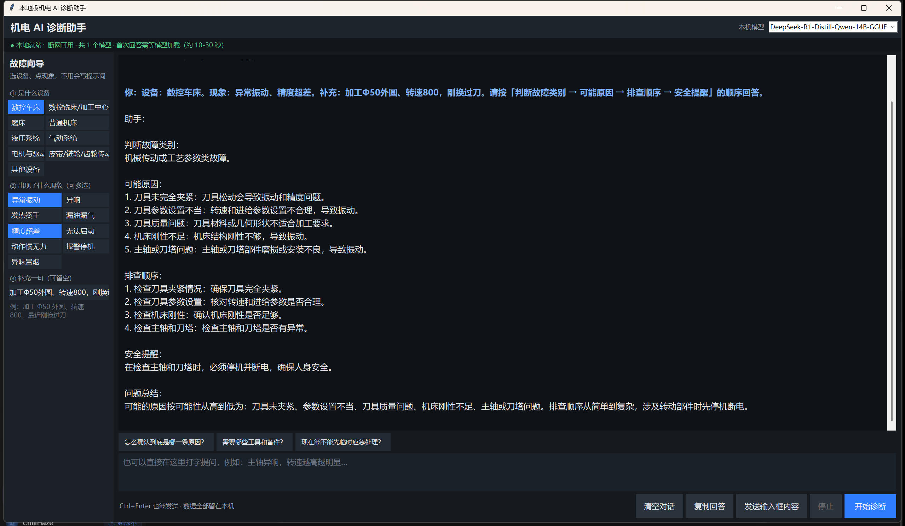

# 本地版机电AI诊断工具

断网也能用的机电设备排故助手：把 14B 大模型跑在**自己的笔记本上**，面向机械/机电现场场景，回答"设备出了这个毛病，可能是哪些原因、按什么顺序排查"。

- 参赛：成都大学第八届网络创新大赛 · AI 创作挑战赛（作品编号 A04）
- 组别：进阶组 · 个人
- 项目形态：D 轻量（本机程序 + 本地模型，不依赖在线 API）
- 起点档：**S0**（赛期开始时没有任何代码，只有本机跑通的模型）



## 一句话说明它是干什么的

现场师傅遇到设备振动、异响、精度超差，过去只能靠经验或者翻手册；问在线 AI 又常常车间没网、单位又不让把设备信息发上网。这个小工具把模型搬进本机，**点两个按钮、不用会写提示词**，就能得到一份"可能原因 + 排查顺序 + 安全提醒"的清单。

## 目前已经能用的功能（v0.3）

| 功能 | 说明 |
|---|---|
| 故障向导 | 左侧点选「设备类型 + 故障现象 + 一句补充」，自动拼成专业提问 |
| 结构化回答 | 强制按「判断类别 → 可能原因 → 排查顺序 → 安全提醒」输出 |
| 一键追问 | 回答后给 3 个追问按钮（怎么确认 / 要什么工具 / 能否应急处理） |
| 多轮对话 | 追问会带上上文，不会每次从零开始 |
| 完全离线 | 模型在本机推理，断网可用；对话不经过任何在线服务 |
| 中途可停 | 生成过程中可以点「停止」 |

## 怎么跑起来

见 [使用说明.md](使用说明.md)。简单说：装 Ollama → `ollama pull` 一个 14B 模型 → 双击 `启动模型服务.bat` → 双击 `启动.bat`。

命令行方式（录屏、做实验记录时更清楚）：

```bash
python app.py --cli "数控车床加工外圆出现明显振纹，可能的原因和排查顺序？"
```

## 当前状态（如实说明）

| 项 | 状态 |
|---|---|
| 本机模型推理 | 已跑通（Ollama + DeepSeek-R1-Distill-Qwen-14B，Q4_K_M 量化） |
| 单次问答实测 | 812 token / 17.8 秒 / 约 46 tok/s（RTX 5070 Ti Laptop，12GB 显存） |
| 图形界面 + 故障向导 | 已完成（本仓库 app.py） |
| 诊断知识库 | 未开始（下一步） |
| 打包成单个 exe | 未开始 |

赛期目标：先把"双击就能开、能提问、拔掉网线也能答"的最小可用版本做扎实，再逐步补本地知识库与故障排查引导。

## 仓库里的文件

| 文件 | 内容 |
|---|---|
| `app.py` | 程序本体（tkinter 界面 + Ollama 本地推理，无第三方依赖） |
| `启动.bat` / `启动模型服务.bat` | 双击启动界面 / 启动本地模型服务 |
| `使用说明.md` | 三分钟上手、断网演示步骤、已知限制 |
| `截图_界面.png` | 实际运行截图（向导 + 结构化回答） |
| `01_起点披露.md` | 起点披露：赛期开始前已有的东西、当时的真实水平 |
| `07_运行环境.txt` | 本机硬件/软件环境实测记录 |
| `08_实测问答记录.txt` | 一次完整问答的原始记录（含耗时与 token 数） |
| `04_本机模型清单_API.png` | 本机模型清单接口的真实截图（`127.0.0.1:11434/api/tags`） |

## 已知限制

- 12 GB 显存下，14B 模型约占 9 GB，**同时不能再加载图像生成模型**。
- 没有机电专业语料微调，专业术语与具体机型手册的准确性有限，回答需人工核对。
- 断网时无法检索网络资料，只能依赖本机知识库（尚未建立）。
- 首次提问需等模型加载 10–30 秒。

## 参赛说明

本项目在赛期内从零开始，起点、每日进展与验证过程记录在赛事追踪平台（起点披露包、进度日志、中期检查、终期材料）。允许使用 AI 工具辅助开发，所有 AI 参与环节会如实记录在《AI 使用记录》中。
